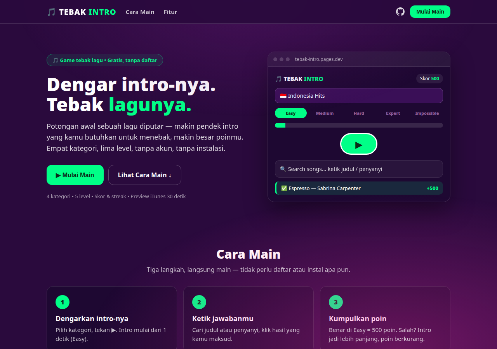
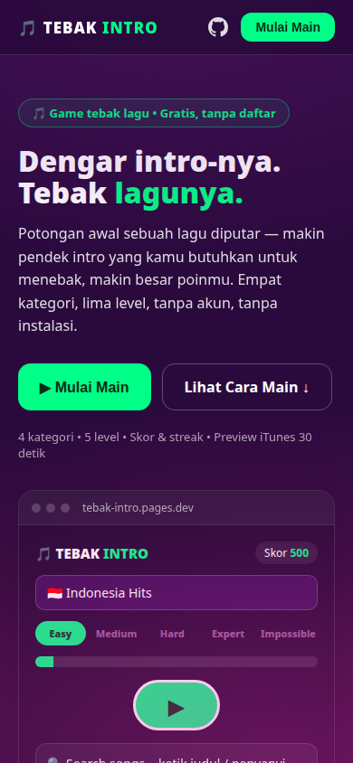
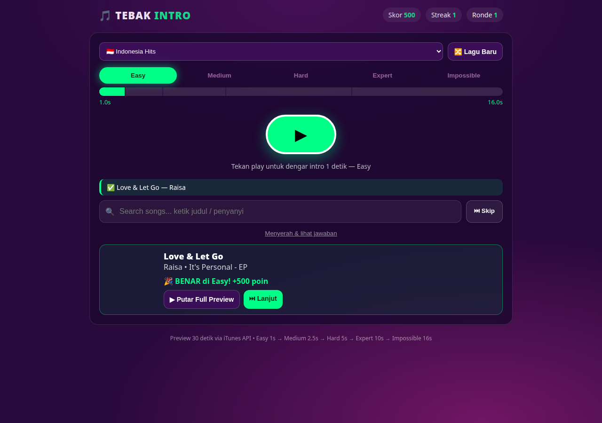

# 🎵 Tebak Intro

[](https://github.com/dezzorigin/intro-guess-game/actions/workflows/ci.yml)
[](https://tebak-intro.pages.dev)
[](LICENSE)

**Tebak lagu dari intro-nya.** Dengarkan potongan awal sebuah lagu — makin
pendek intro yang kamu butuhkan, makin besar poinmu. Buka link, lihat
landing, klik **Mulai Main**, langsung main — tanpa daftar, tanpa instalasi.

👉 **Main sekarang: [https://tebak-intro.pages.dev](https://tebak-intro.pages.dev)**





## Cara main

1. Pilih kategori lagu (Indonesia Hits, Barat Hits, K-Pop, atau TikTok Viral).
2. Tekan tombol ▶ untuk mendengar intro — mulai dari 1 detik (Easy).
3. Ketik judul atau penyanyi di kolom pencarian, lalu klik jawabanmu.
4. Benar? Skor masuk, lanjut ke ronde berikut. Salah? Intro-nya jadi lebih
   panjang — tapi poinmu berkurang.



## Level & skor

| Level | Durasi intro | Poin jawaban benar |
|---|---|---|
| Easy | 1 dtk | 500 |
| Medium | 2,5 dtk | 400 |
| Hard | 5 dtk | 300 |
| Expert | 10 dtk | 200 |
| Impossible | 16 dtk | 100 |

Salah tebak atau Skip naik satu level. Di level Impossible, salah tebak =
kalah (streak kembali 0, jawaban benar di-reveal). Tombol **Lanjut** memuat
lagu baru — ronde naik, skor dipertahankan. Tombol **Menyerah** langsung
menampilkan jawabannya.

## 🎬 Video demo

Dari landing sampai reveal jawaban benar — satu ronde penuh (tanpa suara).
Klik gambar untuk memutar:

[](docs/demo/demo.mp4)

▶️ [Tonton demo (MP4, 7 detik, tanpa suara)](docs/demo/demo.mp4)

## Jalankan lokal

Tidak ada build step, tidak ada dependensi yang perlu diinstal. Cukup sajikan
folder ini sebagai situs statis:

```bash
# dari folder repo
python3 -m http.server 8000
# lalu buka http://localhost:8000
```

Atau dengan Node:

```bash
npx serve .
```

Butuh internet — lagu dan audio preview di-stream dari iTunes Search API.

## Cara kerja

Satu halaman statis (`index.html` + `style.css` + `app.js`). Pengunjung
baru melihat landing dulu (navbar, hero, cara main, fitur); klik **Mulai
Main** menampilkan game — ronde pertama sudah dimuat di latar belakang.
Lagu acak diambil dari iTunes Search API (tanpa key), preview 30 detik
di-stream dari CDN audio iTunes. Tidak ada backend, tidak ada data pengguna
yang dikumpulkan.

Detail lengkap: [docs/architecture.md](docs/architecture.md) (arsitektur,
alur ronde, dan diagram) dan [PRD.md](PRD.md).

## Struktur proyek

```text
index.html                  landing page + halaman game
style.css                   tema ungu-hijau, responsif
app.js                      semua logika game
favicon.svg                 favicon
.github/workflows/ci.yml    html-validate + markdown-link-check
docs/architecture.md        arsitektur & alur game
docs/diagrams/game-flow.svg  diagram alur ronde
docs/screenshots/          screenshot situs live
docs/demo/demo.mp4          video demo satu ronde
PRD.md                      product requirements
CHANGELOG.md                riwayat rilis
```

## Berkontribusi

Perubahan masuk lewat Pull Request ke `main` — CI (html-validate + link
check) harus hijau dulu sebelum merge. Lihat
[CHANGELOG.md](CHANGELOG.md) untuk riwayat rilis.

## Lisensi

MIT — lihat [LICENSE](LICENSE).

---
Dikembangkan oleh **dezzorigin** (Nabil Aulia Dika).
