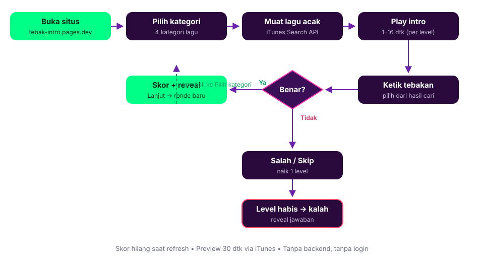

# Arsitektur — Tebak Intro

Dokumen ini menjelaskan cara kerja game dari PRD sampai ke file. Baca
[PRD.md](../PRD.md) untuk ruang lingkup dan kriteria keberhasilan.

## Ringkasan

Tebak Intro adalah satu halaman web statis. Tidak ada framework, tidak ada
build step, tidak ada backend, tidak ada database. Semua logika ada di
`app.js`; semua data lagu dan audio di-stream dari iTunes Search API.

| Lapisan | Isi | Teknologi |
|---|---|---|
| Tampilan | `index.html`, `style.css` | HTML + CSS murni, tema ungu-hijau |
| Logika | `app.js` | JavaScript murni (tanpa dependensi) |
| Data & audio | iTunes Search API + CDN audio iTunes | `fetch`, `<audio>` |
| Deploy | Cloudflare Pages | Upload statis langsung, tanpa build |
| CI | `.github/workflows/ci.yml` | `html-validate` + `markdown-link-check` |

## Alur satu ronde



1. **Buka situs** — `index.html` dimuat, `app.js` langsung memulai ronde 1.
2. **Pilih kategori** — pemain memilih dari 4 kategori. Lagu baru diambil
   dari pool artis kategori itu (10 nama artis per kategori di `POOLS`).
3. **Muat lagu acak** — `fetchSongs()` memanggil iTunes Search API
   (`https://itunes.apple.com/search?term=...&media=music&entity=song&limit=25&country=ID`)
   lalu memilih satu lagu acak dari hasil yang punya `previewUrl`.
   Kalau gagal (tidak ada internet / API tidak terjangkau), tampil pesan
   gagal load dan tombol Lagu Baru.
4. **Play intro** — tombol play memutar preview sepanjang durasi level aktif,
   lalu berhenti sendiri. Level: Easy 1 dtk, Medium 2,5 dtk, Hard 5 dtk,
   Expert 10 dtk, Impossible 16 dtk.
5. **Tebak** — pemain mengetik judul/penyanyi; setiap ketikan (debounce
   350 ms) memanggil iTunes Search API lagi dan menampilkan maks. 8 hasil.
   Klik satu hasil = satu tebakan.
6. **Penilaian** — jawaban benar kalau `trackId` sama, atau judul yang
   dinormalisasi sama persis. Benar: skor += (5 − level) × 100, streak +1,
   kartu reveal tampil. Salah atau Skip: naik satu level. Di level
   Impossible, salah = kalah (streak reset 0, reveal jawaban).
7. **Ronde berikut** — tombol Lanjut memuat lagu baru, ronde +1, skor
   dipertahankan. Skor hilang kalau halaman di-refresh.

## Peta file

```text
index.html                  struktur halaman + semua id yang dipakai app.js
style.css                   tema ungu (#2a0a3d) + hijau (#00ff87), responsif 600px
app.js                      semua logika: STAGES, POOLS, fetchSongs, newRound,
                            playClip/stopClip, pencarian, penilaian, reveal
favicon.svg                 favicon (nada + play)
.github/workflows/ci.yml    html-validate + markdown-link-check
docs/architecture.md        dokumen ini
docs/diagrams/game-flow.svg  diagram alur ronde
docs/screenshots/          screenshot situs live untuk README
docs/demo/demo.mp4          video demo satu ronde (tanpa suara)
```

## Aliran data (tanpa backend)

```text
Browser ──fetch──▶ iTunes Search API ──JSON──▶ Browser
   │                                   (trackName, artistName,
   │                                    previewUrl, artworkUrl60/100)
   └──▶ <audio> ──stream──▶ audio-ssl.itunes.apple.com (preview 30 dtk)
```

Tidak ada data yang dikirim ke server mana pun selain iTunes. Tidak ada
cookie, tidak ada analitik, tidak ada akun.

## Keputusan desain

- **Statis tanpa framework** — game ini tidak butuh state server; satu file
  JS cukup, dan deploy-nya tinggal upload file.
- **iTunes, bukan file audio di repo** — preview legal, gratis, tanpa key,
  dan repo tetap 12 KB.
- **Pencarian ulang per ketikan** — jawaban yang bisa ditebak adalah lagu
  apa pun yang ada di iTunes, bukan hanya pool kategori (pool hanya dipakai
  untuk memilih lagu yang ditanyakan).
- **Skor sesi saja** — sengaja tanpa localStorage di rilis ini; penyimpanan
  skor masuk roadmap berikutnya.

## Batasan yang diketahui

- Kalau iTunes API tidak terjangkau, ronde tidak bisa dimuat (pesan error
  jelas, tidak crash).
- Kualitas tebakan tergantung hasil pencarian iTunes; lagu yang tidak ada di
  iTunes tidak bisa ditebak.
- Audio butuh koneksi; di jaringan lambat, klip bisa mulai terlambat —
  `play()` ditangkap promise-nya supaya tidak melempar error.
- Skor dan streak hilang saat refresh.

## Deploy

Cloudflare Pages, proyek `tebak-intro` → https://tebak-intro.pages.dev.
Upload langsung file statis (`index.html`, `app.js`, `style.css`,
`favicon.svg`) tanpa build step. Setiap rilis: upload ulang file yang
berubah, lalu verifikasi live (main satu ronde penuh).
